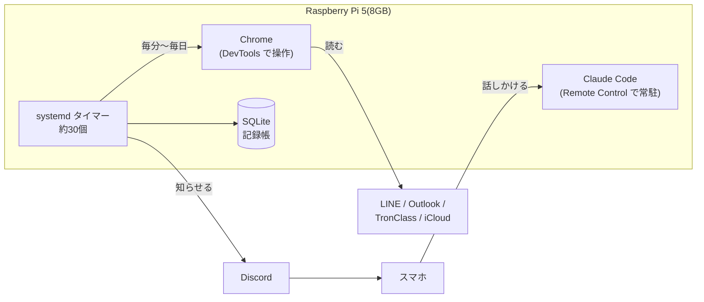

<!-- 【本人メモ】ここに一言、自分の言葉で書く(なぜ作ったか・作ってどうだったか)。2〜3行でOK -->

台湾の大学で工業工程(IE)を学んでいる日本人の1年生です。
授業は中国語と英語、連絡は LINE・Outlook・学校の LMS(TronClass)・iCloud とバラバラ。入学して1か月、「全部を追いかけるのは人間には無理では?」と思い、**Raspberry Pi 5 の上で24時間動く AI 秘書「hotaru(ほたる)」** を作りました。

この記事では、hotaru が何をしてくれるのか、どういう仕組みで動いているのか、作ってみてハマったところを紹介します。

## hotaru がやってくれること

- **連絡の見張り**: LINE と Outlook を毎分、TronClass を5分ごとに確認。大事な新着だけを Discord に知らせる
- **予定と課題の管理**: 毎朝 7:30 に「今日の予定」、夜 19:00 に「今後1週間」を Discord に投稿。課題は「発見 → 作成中 → 完成 → 提出 → 受理」で追いかける
- **授業の録音の文字起こし**: iPhone で録った録音を科目・日付ごとに整理して文字起こし
- **授業の質問に答える先生役**: Discord で質問すると、その科目の教材だけを読んで答えてくれる
- **秘書(お金と手続き)**: 家計簿・期限の見張り・パスワードの金庫。ついでに X のセール情報を見張って「安いメモリが出たよ」と教えてくれる

スマホからは、Discord と Claude Code の Remote Control で話しかけるだけです。

## 全体の構成



ポイントは、**「AI にずっと考えさせる」のではなく、「決まった仕事は Python と systemd に任せ、判断が要るところだけ AI に聞く」** ことです。

## 仕組みのポイント

### 1. 決まった仕事は systemd のタイマーで

見張り・まとめ・文字起こし・バックアップなどは、全部 systemd のユーザータイマーで動かしています。いま約30個あります。

```ini:secretary-xdeals.timer
[Timer]
OnCalendar=*:03/10
RandomizedDelaySec=60
```

cron より、止まったときに `systemctl --user status` ですぐ原因が見られるのが楽でした。

### 2. ログインが要るサイトは「Chrome を DevTools で操作」

学校の LMS や Outlook は API が使えないので、Pi の上で Chrome を1つ常駐させ、Playwright から `connect_over_cdp` で操作しています。ログインは人間が1回すれば、あとは保たれます。

複数の見張りが同じ Chrome を触るので、**サイトごとのファイルロック**を用意して、同じタブを同時に触らないようにしています。

### 3. AI は「安い順」に試す

まとめや「この通知は大事か?」の判定は、`ask-llm` という小さなスクリプトを通しています。安い(無料枠のある)AI から順に試して、だめなときだけ最後に Claude を使います。毎分動く見張りで毎回いちばん高いモデルを呼ぶと、すぐにお金が溶けるからです。

### 4. 担当を分けて、引き継ぎメモで共有

1つの会話に全部やらせると、文脈がすぐにいっぱいになります。そこで担当を分けました。

- **メイン**: 機能づくり・設定の変更
- **サブ**: 状況確認・調べもの(ファイルは書き換えない)
- **先生役**: 授業の質問に答える(教材フォルダしか読めない)
- **秘書**: お金・期限・パスワード

それぞれが `CLAUDE.md` で役割を決め、`HANDOFF.md`(引き継ぎメモ)に結果を書いて共有します。本人が「提出した」「不要」と言ったことは、全担当が読む「本人の申告」ファイルに残します。

### 5. 毎時の自己点検

止まったサービス・文字起こしの詰まり・バックアップの失敗を、毎時 `hotaru-doctor` が点検して、問題があれば知らせます。**「静かなのは、うまく動いているからとは限らない」** というのを、数日止まっていたのに気づかなかった経験で学びました。

## ハマったところ

- **Discord のタブで Chrome ごと固まる**: Discord を開いたタブに応答しないワーカーができ、Playwright の接続全体が止まった。Discord はボット経由で操作することにして、タブは開かないようにした
- **「新しいタブ」がメモリを1.3GB食う**: 時間がたつと膨らむので、定期的に空のタブに置き換えている
- **タブ整理が、開いたばかりのタブを閉じる**: 掃除役が「空のタブ」と思って閉じてしまう。ロックを取っている間は閉じないようにした
- **LINE の既読**: 読むだけで既読が付くと困るので、既読を送る処理を止めて読んでいる

<!-- 【本人メモ】いちばん困った・笑ったエピソードがあれば1つ足す -->

## かかっているお金

- Raspberry Pi 5(8GB)本体と周辺機器
- AI の利用料(Claude の課金と、ほかの AI の無料枠)

<!-- 【本人メモ】月にいくらかかっているか、書いてよければ書く -->

## これから

- hotaru の骨組みを、誰でも試せる形(`hotaru-starter`)で公開する予定です
- 授業資料の自動収集や家計簿の取り込みなど、詳しい作り方も順番に書いていきます

質問や「うちの大学でもやりたい」などあれば、気軽にコメントや X(@hotarulab)でどうぞ。
